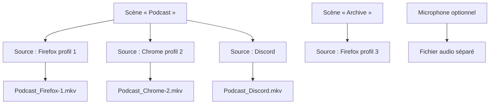
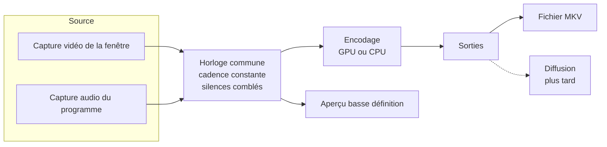

# Polyptyque - Cahier des charges

> [!abstract] Résumé
> Polyptyque est un logiciel d'enregistrement multi-sources. Il capture en même temps plusieurs fenêtres (navigateurs, applications, jeux) et enregistre chacune, avec **son propre son isolé**, dans un **fichier MKV distinct**.
> Usages visés : montage multi-angle et archivage, sur des sessions pouvant durer **jusqu'à 12 heures**.
> Plateforme : Windows d'abord, architecture prévue dès le départ pour un portage macOS et Linux.
> Priorité absolue : **fiabilité**, puis performance, puis simplicité d'usage.

## Table des matières

1. [[#Contexte et objectifs]]
	1. [[#Besoin]]
	2. [[#Priorités]]
2. [[#Périmètre]]
	1. [[#Inclus dans la version 1]]
	2. [[#Exclus de la version 1]]
3. [[#Concepts]]
4. [[#Exigences fonctionnelles]]
	1. [[#Scènes]]
	2. [[#Sources navigateur]]
	3. [[#Sources application]]
	4. [[#Reconnaissance et restauration des fenêtres]]
	5. [[#Enregistrement]]
	6. [[#Microphone]]
	7. [[#Fichiers de sortie et nommage]]
	8. [[#Conversion MKV vers MP4]]
	9. [[#Réglages d'encodage]]
	10. [[#Interface]]
	11. [[#Raccourcis clavier]]
	12. [[#Préparation de la diffusion en direct]]
5. [[#Exigences non fonctionnelles]]
	1. [[#Fiabilité]]
	2. [[#Performance]]
	3. [[#Compatibilité]]
	4. [[#Sécurité et vie privée]]
6. [[#Limites connues]]
7. [[#Architecture technique]]
	1. [[#Chaîne de traitement]]
	2. [[#Découpage du code]]
	3. [[#Technologies]]
	4. [[#Portage macOS et Linux]]
8. [[#Feuille de route]]
9. [[#Journal des décisions]]
10. [[#Questions ouvertes]]
11. [[#Sources]]

---

## Contexte et objectifs

### Besoin

[[OBS Studio]] n'enregistre qu'**un seul fichier à la fois** : toutes les sources sont mélangées dans une seule image et un seul son. Le besoin est l'inverse :

- capturer plusieurs fenêtres en parallèle (par exemple trois fenêtres de navigateur) ;
- produire **un fichier par fenêtre** ;
- dans chaque fichier, **uniquement le son émis par cette fenêtre**, ni le son du système, ni celui des autres fenêtres.

Les fenêtres capturées doivent être **reconnues de façon fiable** d'une session à l'autre, et rouvertes automatiquement si elles ne le sont pas.

### Priorités

| Rang | Priorité | Traduction concrète |
|---|---|---|
| 1 | Fiabilité | 12 h d'enregistrement sans perte, fichiers toujours lisibles, même après un plantage |
| 2 | Performance | Encodage par la carte graphique dès que possible, impact minimal sur la machine |
| 3 | Simplicité | Interface proche d'[[OBS Studio]] mais allégée, centrée sur le multi-enregistrement |
| 4 | Compatibilité | Fonctionner sur le plus grand nombre de machines Windows, avec dégradation propre |

---

## Périmètre

### Inclus dans la version 1

- Sources de type **navigateur géré** (profil dédié par source) et **application** (fenêtre quelconque).
- Plusieurs **scènes**, au sens de groupes de sources, verrouillées pendant l'enregistrement.
- Un **fichier MKV par source**, vidéo et son dans le même fichier.
- **Microphone** optionnel, enregistré dans un fichier séparé.
- **Conversion MKV vers MP4** sans perte.
- **Aperçu en direct** de toutes les sources en même temps.
- Réglages d'encodage, nommage des fichiers, raccourcis clavier.

### Exclus de la version 1

> [!info] Hors périmètre, mais anticipé
> - **Diffusion en direct** (streaming) : non développée, mais l'architecture est prévue pour l'ajouter plus tard. Si elle est ajoutée, elle sera gratuite.
> - **Portage macOS et Linux** : seul le module de capture sera à réécrire (voir [[#Portage macOS et Linux]]).

> [!failure] Abandonné
> - **Transitions et fichier « programme »** à la façon d'OBS : abandonnés. Dans Polyptyque, chaque source a son propre fichier, une transition entre scènes n'y aurait aucun sens.
> - **Composition** (placer et redimensionner plusieurs sources dans une même image) : abandonnée pour la même raison.
> - **Navigateur intégré** : écarté. Il ne couvrirait ni Discord, ni les jeux, ni Tor. Il imposerait de maintenir un moteur de navigation à jour (sécurité) et ferait perdre à l'utilisateur ses navigateurs, extensions et gestionnaires de mots de passe.
> - **Extension de navigateur** : écartée. La capture audio par onglet n'existe que sous Chromium, pas sous Firefox.

---

## Concepts



| Concept | Définition |
|---|---|
| **Scène** | Groupe nommé de sources, correspondant à un usage (« Podcast », « Archive »…). Une seule scène est active à la fois. |
| **Source** | Une fenêtre capturée avec son son isolé. Produit un fichier. |
| **Source navigateur** | Navigateur lancé par Polyptyque avec un profil qui lui est dédié. |
| **Source application** | Toute autre fenêtre : Discord, jeu, Tor Browser, logiciel quelconque. |
| **Profil dédié** | Dossier de profil de navigateur propre à une source. Il conserve connexions, cookies et onglets. |
| **Enregistrement** | Période pendant laquelle les sources de la scène active écrivent leurs fichiers. |

---

## Exigences fonctionnelles

### Scènes

- Créer, renommer, dupliquer, supprimer des scènes.
- Une scène contient une liste ordonnée de sources.
- **Verrouillage pendant l'enregistrement** : tant qu'au moins une source enregistre, il est impossible de :
	- changer de scène ;
	- ajouter ou supprimer une source ;
	- modifier les réglages d'encodage.
- La scène active à la fermeture est rouverte au lancement suivant.

### Sources navigateur

- **Détection des navigateurs installés** via la liste tenue par Windows (registre `StartMenuInternet`), plus la possibilité d'indiquer un exécutable à la main.
- **Choix du navigateur** à la création de chaque source.
- Familles gérées (chaque navigateur sera vérifié individuellement) :

| Famille | Exemples | Lancement avec profil dédié |
|---|---|---|
| Gecko (Firefox) | Firefox, LibreWolf, Waterfox, Zen, Floorp | `-profile "<dossier>" -no-remote` |
| Chromium | Chrome, Edge, Brave, Vivaldi, Opera | `--user-data-dir="<dossier>"` |

- **Un profil dédié par source**, stocké dans le dossier de données de Polyptyque (`%LOCALAPPDATA%\Polyptyque\profils\<identifiant>`).
- **Connexions conservées** : le profil est permanent, l'utilisateur ne se connecte qu'une fois par profil.
- **Restauration des onglets** : Polyptyque configure le profil pour rouvrir les onglets de la session précédente (Firefox : `browser.startup.page = 3` ; Chromium : « Continuer là où vous vous êtes arrêté »).
- **Adresse de départ** optionnelle, utilisée au premier lancement du profil.

> [!warning] Règle d'or des profils
> Le son est isolé **par profil**, pas par onglet. Tout son joué dans n'importe quel onglet ou fenêtre d'un profil se retrouve dans le fichier de la source correspondante. Une source = un profil = uniquement ce qui doit être entendu.

> [!note] Tor Browser
> Tor Browser est traité comme une **source application** : capture de sa fenêtre et de son son (isolé, car il tourne comme un programme séparé), **sans** profil géré ni connexion conservée. C'est le fonctionnement voulu par Tor (effacement à la fermeture).

### Sources application

- Sélection d'une fenêtre ouverte dans une liste (titre, icône, nom du programme).
- Informations mémorisées : chemin de l'exécutable, classe de fenêtre, titre de la fenêtre, arguments de lancement éventuels.
- **Relance automatique** optionnelle, réglable par source (utile pour Discord, pas toujours souhaitable pour un jeu lancé depuis Steam).
- Option par source : afficher ou non le curseur de la souris (affiché par défaut).

### Reconnaissance et restauration des fenêtres

Au lancement de Polyptyque, pour chaque source de la scène active :

1. **Source navigateur** : recherche du processus dont la ligne de commande contient le dossier du profil dédié. S'il existe, sa fenêtre principale est rattachée ; sinon, le navigateur est relancé avec ce profil.
2. **Source application** : recherche par ordre de précision décroissante :
	1. même exécutable, même classe et même titre ;
	2. même exécutable et même classe ;
	3. même exécutable, si une seule fenêtre correspond ;
	4. sinon : relance (si activée) ou demande de confirmation à l'utilisateur en cas d'ambiguïté.
3. Chaque source affiche son état : **connectée**, **en attente**, **introuvable**.

> [!tip] Pourquoi c'est fiable pour les navigateurs
> L'identifiant d'une fenêtre change à chaque ouverture, et le titre d'une fenêtre de navigateur change avec l'onglet affiché. Le dossier de profil, lui, ne change jamais : c'est la clé de reconnaissance.

### Enregistrement

- **Bouton global** : démarre toutes les sources de la scène active **au même instant**, sur une **horloge commune**.
- **Enregistrement individuel** : chaque source peut aussi être démarrée ou arrêtée seule.
- **Cadence constante** : Windows n'envoie une image que lorsque la fenêtre change ; Polyptyque répète la dernière image pour garantir une cadence fixe (indispensable aux logiciels de montage).
- **Son continu** : les silences sont comblés pour que le son reste calé sur l'image.
- **Fenêtre perdue** (fermée, plantée) : le fichier continue avec une **image noire et du silence** ; la source est **rattachée automatiquement** dès que la fenêtre réapparaît.
- **Fenêtre réduite** : Windows ne la dessine plus, l'image se fige ; un avertissement s'affiche.
- **Fenêtre redimensionnée** : la résolution du fichier reste fixe, l'image est mise à l'échelle en conservant ses proportions, avec des bandes noires si besoin.
- **Mise en veille de Windows bloquée** pendant l'enregistrement.

### Microphone

- **Désactivé par défaut.**
- Activation dans les réglages, avec **demande de confirmation explicite** à l'utilisateur, en respectant les autorisations de confidentialité de Windows.
- Choix du périphérique d'entrée.
- Enregistré dans un **fichier audio séparé**, sur la même horloge que les vidéos.

> [!question] Format du fichier micro
> Le WAV classique est limité à 4 Go, soit environ 6 h en stéréo 48 kHz 16 bits : insuffisant pour 12 h. Piste envisagée : conteneur Matroska audio (`.mka`), avec la même robustesse que les vidéos. Compatibilité avec les logiciels de montage à vérifier.

### Fichiers de sortie et nommage

- **Un fichier MKV par source**, vidéo et son dans le même fichier.
- **Dossier de sortie** configurable.
- **Nom de chaque source** défini par l'utilisateur.
- **Modèle de nom commun**, avec variables :

| Variable | Exemple |
|---|---|
| `{date}` | `2026-10-20` |
| `{heure}` | `14h32` |
| `{scène}` | `Podcast` |
| `{source}` | `Discord` |

- Modèle par défaut : `{date}_{heure}_{scène}_{source}` → `2026-10-20_14h32_Podcast_Discord.mkv`
- **Aucun écrasement** : si le fichier existe, un suffixe numérique est ajouté.
- **Découpage automatique** optionnel (toutes les N heures ou N Go), désactivé par défaut.

### Conversion MKV vers MP4

Le MKV est utilisé pendant l'enregistrement pour sa robustesse : un fichier MKV interrompu reste lisible, un MP4 interrompu est souvent perdu. Certains logiciels de montage ([[Premiere Pro]] notamment) gèrent mal le MKV, d'où une fonction de conversion.

- **Conversion sans réencodage** (« remuxage ») : les données vidéo et audio sont recopiées telles quelles dans un conteneur MP4. Aucune perte de qualité, opération rapide.
- Déclenchement :
	- **manuel** : sélection d'un ou plusieurs fichiers ;
	- **automatique** (option) : conversion à la fin de chaque enregistrement, en conservant le MKV d'origine.
- Vérification de la conversion (durée, pistes) avant de la déclarer réussie.

> [!warning] À vérifier en test
> Certains utilisateurs signalent des craquements audio après un remuxage. La conversion devra être validée sur de longs fichiers, dans [[Premiere Pro]] et [[DaVinci Resolve]].

### Réglages d'encodage

Réglages **communs à toutes les sources** dans la version 1.

| Réglage | Valeurs | Défaut |
|---|---|---|
| Matériel d'encodage | Automatique, carte graphique (GPU), processeur (CPU) | Automatique (GPU si disponible) |
| Encodeur | Détecté : NVIDIA NVENC, AMD AMF, Intel Quick Sync, logiciel | Le meilleur disponible |
| Codec | H.264, HEVC (selon le matériel) | H.264 (compatibilité maximale au montage) |
| Résolution | 720p, 1080p, 1440p, 2160p, personnalisée | 1080p |
| Images par seconde | 24, 25, 30, 50, 60, personnalisé | 60 |
| Contrôle du débit | Débit constant (CBR), débit variable (VBR), qualité constante | À définir |
| Débit vidéo | En kb/s | À définir après mesures (piste : 12 000 kb/s en 1080p60) |
| Préréglage | Vitesse ↔ qualité | Équilibré |
| Audio | AAC 48 kHz stéréo, débit en kb/s | 192 kb/s |

> [!info] Estimation d'espace disque
> À 12 000 kb/s, une source occupe environ **5,4 Go par heure**, soit environ **65 Go en 12 h** ; trois sources occupent environ **195 Go**.

### Interface

Inspirée d'[[OBS Studio]], volontairement allégée, thème sombre.

```text
┌────────────────────────────────────────────────────────────┐
│ Polyptyque                               ● REC  02:14:37   │
├────────────────────────────────────────────────────────────┤
│ ┌───────────────┐  ┌───────────────┐  ┌───────────────┐    │
│ │   Source 1    │  │   Source 2    │  │    Discord    │    │
│ │   (aperçu)    │  │   (aperçu)    │  │   (aperçu)    │    │
│ │ ● 60 i/s ▮▮▮▯ │  │ ● 60 i/s ▮▮▯▯ │  │ ● 60 i/s ▮▯▯▯ │    │
│ └───────────────┘  └───────────────┘  └───────────────┘    │
├──────────────┬────────────────────┬────────────────────────┤
│ Scènes       │ Sources            │ Commandes              │
│ > Podcast    │  Source 1 (Firefox)│ [ Démarrer tout ]      │
│   Archive    │  Source 2 (Chrome) │ [ Paramètres ]         │
│              │  Discord           │ Disque : 412 Go libres │
│ [+] [-]      │ [+] [-] [⚙]        │ ≈ 31 h restantes       │
└──────────────┴────────────────────┴────────────────────────┘
```

- **Grille d'aperçus** de toutes les sources de la scène, en basse définition pour ne pas pénaliser l'enregistrement, désactivable.
- Par source : nom, état, cadence réelle, indicateur de niveau sonore, durée, taille du fichier, bouton d'enregistrement individuel.
- **Barre d'état** : espace disque libre, autonomie estimée, charge processeur et carte graphique, images perdues.
- **Fenêtre de paramètres** : Sortie, Encodage, Audio, Raccourcis, Général.
- Langue : français au départ, textes externalisés pour permettre la traduction (public visé : grand public).
- Accessibilité : navigation complète au clavier, compatibilité lecteur d'écran selon la technologie d'interface retenue.

### Raccourcis clavier

- **Globaux** : actifs même quand Polyptyque est en arrière-plan.
- **Tous configurables**, avec quelques propositions par défaut :

| Action | Proposition |
|---|---|
| Démarrer / arrêter tout | <kbd>Ctrl</kbd> + <kbd>Maj</kbd> + <kbd>F9</kbd> |
| Afficher / masquer Polyptyque | <kbd>Ctrl</kbd> + <kbd>Maj</kbd> + <kbd>F10</kbd> |
| Activer / couper les aperçus | <kbd>Ctrl</kbd> + <kbd>Maj</kbd> + <kbd>F11</kbd> |

> [!tip] Pourquoi pas Ctrl + Alt
> Sur un clavier AZERTY, <kbd>Ctrl</kbd> + <kbd>Alt</kbd> équivaut à <kbd>AltGr</kbd> : ces combinaisons entreraient en conflit avec la saisie de caractères (€, @, #…).

### Préparation de la diffusion en direct

Non développée en version 1. L'architecture sépare **l'encodage** de **la destination** : chaque flux encodé est envoyé vers une ou plusieurs « sorties ». Seule la sortie « fichier » existe en version 1 ; une sortie « diffusion » (RTMP, SRT) pourra être ajoutée sans refonte.

---

## Exigences non fonctionnelles

### Fiabilité

- [ ] Tenir **12 h** d'enregistrement continu avec plusieurs sources.
- [ ] Fichiers MKV écrits au fil de l'eau, **lisibles même après un plantage** ou une coupure de courant.
- [ ] **Désynchronisation** entre fichiers inférieure à une image (16 ms à 60 i/s) sur 12 h, à mesurer.
- [ ] **Isolation des pannes** : une source en échec n'interrompt jamais les autres.
- [ ] **Surveillance du disque** : estimation avant démarrage, alertes par paliers, arrêt propre (fichiers correctement fermés) si l'espace vient à manquer.
- [ ] **Mémoire stable** sur 12 h (aucune fuite), vérifiée par des tests d'endurance.
- [ ] **Journal technique** détaillé pour le diagnostic.

### Performance

- Chaîne **entièrement sur la carte graphique** quand c'est possible : capture, mise à l'échelle et encodage sans repasser par la mémoire centrale.
- Encodage par le processeur disponible en secours, ou sur choix de l'utilisateur.
- Aperçus en basse définition et désactivables.
- Compteur d'images perdues par source.

### Compatibilité

| Élément | Exigence |
|---|---|
| Système | Windows 10 22H2 et Windows 11, 64 bits |
| Son isolé par programme | Windows 10 version 2004 ou plus récent (la documentation Microsoft indique la build 20348) |
| Bordure jaune de capture | Retirée quand Windows le permet (Windows 11) ; affichée sinon, sans contournement |
| Encodeurs | Détection au démarrage de NVENC, AMF, Quick Sync ; encodeur logiciel en secours |
| Limites d'encodage | Test au démarrage du nombre de flux encodables ; avertissement ou refus avant de dépasser la capacité |

> [!example] Machine de référence (tests)
> - Processeur : AMD Ryzen 7 5800X (sans partie graphique intégrée)
> - Carte graphique : NVIDIA RTX 3080 10 Go (une puce NVENC, H.264 et HEVC, **pas d'AV1 en encodage**)
> - Système : Windows 11

### Sécurité et vie privée

- Les profils de navigateur contiennent des **sessions connectées** : stockés uniquement en local, jamais transmis.
- Microphone désactivé par défaut, activation explicite.
- Aucune donnée envoyée sur Internet par Polyptyque (proposition, voir [[#Questions ouvertes]]).

---

## Limites connues

| Limite | Cause | Conséquence ou contournement |
|---|---|---|
| Son isolé par programme, pas par fenêtre | Fonctionnement de Windows | Un profil de navigateur dédié par source |
| Tous les onglets d'un profil partagent le son | Un profil = un programme | Ne garder dans un profil que ce qui doit être entendu |
| Fenêtre réduite = image figée | Windows ne dessine plus une fenêtre réduite | Garder les fenêtres ouvertes, même cachées derrière d'autres |
| Contenus protégés (Netflix, Disney+…) souvent noirs | Protection anticopie | Aucun contournement prévu |
| Certains jeux en plein écran exclusif donnent une image noire | Mode d'affichage du jeu | Utiliser le mode « fenêtré sans bordure » |
| Son joué par un autre programme que celui de la fenêtre | Architecture de certains logiciels | Avertissement affiché ; son non capturé |
| Tor Browser ne conserve pas les connexions | Choix de conception de Tor | Accepté |
| Certains sites déconnectent après un délai | Politique des sites | Hors de contrôle |
| Bordure jaune sur Windows 10 | Pas de méthode pour la retirer | Accepté |
| AV1 indisponible sur RTX 30 | Matériel | Codecs proposés selon la carte détectée |

> [!bug] Point à surveiller
> Des utilisateurs d'OBS signalent que la capture audio d'un navigateur échoue selon qu'il a été ouvert avant ou après le logiciel de capture. Comme Polyptyque lance lui-même les navigateurs, le risque est réduit, mais il sera testé explicitement.

---

## Architecture technique

### Chaîne de traitement



### Découpage du code

Le code est organisé en modules indépendants (« crates » Rust) :

| Module | Rôle | Dépend du système |
|---|---|---|
| `core` | Scènes, sources, réglages, sauvegarde, horloge, nommage, orchestration | Non |
| `capture` | Interface commune de capture vidéo et audio | Non |
| `capture-windows` | Implémentation Windows de la capture | **Oui** |
| `encode` | Encodeurs, multiplexage MKV, conversion MP4 | Non (sauf détection matérielle) |
| `browsers` | Détection des navigateurs, profils, lancement | Partiellement |
| `app` | Interface graphique | Non |

### Technologies

| Besoin | Choix | Remarque |
|---|---|---|
| Langage | [[Rust]] | Rapide, sûr en mémoire, adapté aux traitements longs |
| Accès à Windows | Crate officielle Microsoft `windows` | |
| Capture vidéo | Windows.Graphics.Capture | Capture par fenêtre, même cachée derrière d'autres |
| Capture audio | WASAPI « process loopback », mode arbre de processus | Son d'un programme et de ses sous-programmes |
| Encodage et MKV | Bibliothèques [[FFmpeg]] (liaison dynamique, version LGPL) | NVENC, AMF, Quick Sync, logiciel |
| Interface | Interface native dessinée par la carte graphique (egui ou Slint, à trancher à l'étape 2) | Pas de page web embarquée, pour afficher plusieurs aperçus vidéo sans coût excessif |
| Sauvegarde des scènes | Fichier de configuration dans `%APPDATA%\Polyptyque` | |
| Fabrication des exécutables | GitHub Actions sur machine Windows | |

### Portage macOS et Linux

Seul le module `capture-…` est à réécrire pour chaque système, ainsi qu'une partie de `browsers` (emplacements des navigateurs). Pistes à étudier le moment venu : ScreenCaptureKit sous macOS, PipeWire sous Linux. L'isolation du son par programme y sera à revérifier.

---

## Feuille de route

> [!todo] Étape 0 - Prototype de validation des risques
> - [ ] Son isolé par profil : deux fenêtres Firefox et deux fenêtres Chrome, sons différents, fichiers propres
> - [ ] Retrait de la bordure jaune sous Windows 11
> - [ ] Nombre de flux 1080p60 encodables en parallèle sur la RTX 3080
> - [ ] Test d'endurance de 1 h, puis de 12 h ; vérification de la synchronisation et de la lisibilité des fichiers

> [!todo] Étape 1 - Moteur d'enregistrement
> - [ ] Capture, horloge commune, cadence constante, encodage, MKV
> - [ ] Gestion des fenêtres perdues et rattachement automatique
> - [ ] Surveillance du disque, anti-veille, journal technique

> [!todo] Étape 2 - Interface
> - [ ] Scènes, sources, grille d'aperçus, paramètres, nommage
> - [ ] Verrouillage pendant l'enregistrement

> [!todo] Étape 3 - Navigateurs gérés
> - [ ] Détection, profils dédiés, lancement, restauration des onglets, reconnaissance au démarrage

> [!todo] Étape 4 - Finitions et fiabilité
> - [ ] Microphone, raccourcis globaux, conversion MP4
> - [ ] Tests d'endurance de 12 h complets, installateur

> [!info] Plus tard
> - Diffusion en direct (gratuite)
> - Portage macOS, puis Linux
> - Réglages d'encodage par source

---

## Journal des décisions

| Date | Décision |
|---|---|
| 2026-10-20 | Développement en [[Rust]], Windows d'abord, architecture multi-systèmes |
| 2026-10-20 | Son isolé obtenu par **un profil de navigateur dédié par source**, lancé par Polyptyque |
| 2026-10-20 | Pas de navigateur intégré, pas d'extension de navigateur |
| 2026-10-20 | Scènes = groupes de sources, **verrouillées pendant l'enregistrement** ; pas de transitions ni de composition |
| 2026-10-20 | Tor Browser traité comme une application, sans connexion conservée |
| 2026-10-20 | Fenêtre perdue : image noire et silence, rattachement automatique |
| 2026-10-20 | MKV pendant l'enregistrement, conversion MP4 sans perte en option |
| 2026-10-20 | Défauts : 1080p, 60 i/s, H.264, encodage GPU si disponible, choix GPU ou CPU laissé à l'utilisateur |
| 2026-10-20 | Bordure jaune retirée sous Windows 11 uniquement, sans contournement ailleurs |
| 2026-10-20 | Microphone optionnel, désactivé par défaut, fichier séparé |
| 2026-10-20 | Bouton d'enregistrement global et enregistrement individuel par source |
| 2026-10-20 | Diffusion en direct hors version 1, architecture prête, gratuite si ajoutée |
| 2026-10-20 | Modèle de nom par défaut : `{date}_{heure}_{scène}_{source}` |

---

## Questions ouvertes

- [ ] **Distribution du logiciel** : gratuit ou payant ? Code source ouvert ou fermé ? Impacts :
	- l'encodeur logiciel de référence (x264) impose de publier le code source de Polyptyque ; l'alternative libre de cette contrainte (OpenH264) offre une qualité moindre ;
	- une signature numérique de l'exécutable évite l'alerte « Windows a protégé votre ordinateur », pour un coût annuel.
- [ ] **Restauration au démarrage** : proposition de ne relancer que les sources de la scène active (et non de toutes les scènes).
- [ ] **Télémétrie** : proposition d'aucune collecte de données.
- [ ] **Format du fichier micro** : `.mka` envisagé, compatibilité montage à vérifier.
- [ ] **Débit vidéo par défaut** : à fixer après mesures sur la machine de référence.
- [ ] **Technologie d'interface** : egui ou Slint, à trancher à l'étape 2.

---

## Sources

- [Microsoft - Mode de capture audio par processus](https://learn.microsoft.com/en-us/windows/win32/api/audioclientactivationparams/ne-audioclientactivationparams-process_loopback_mode)
- [Microsoft - Exemple de capture audio d'une application](https://learn.microsoft.com/en-us/samples/microsoft/windows-classic-samples/applicationloopbackaudio-sample/)
- [Microsoft - IsBorderRequired (bordure jaune)](https://learn.microsoft.com/en-us/uwp/api/windows.graphics.capture.graphicscapturesession.isborderrequired)
- [OBS - Guide de la capture audio d'application](https://obsproject.com/kb/application-audio-capture-guide)
- [Mozilla audioipc - Son des onglets joué par le processus principal](https://github.com/mozilla/audioipc)
- [NVIDIA - Matrice des encodeurs vidéo](https://developer.nvidia.com/video-encode-and-decode-gpu-support-matrix-new)
- [Tor Browser - Effacement des cookies à la fermeture](https://gitlab.torproject.org/tpo/applications/tor-browser/-/issues/33540)
- [Adobe - Retour du support MKV dans Premiere Pro](https://community.adobe.com/t5/premiere-pro-ideas/what-happened-to-mkv-support-it-was-in-beta-2024-but-it-s-not-in-2025/idi-p/15080697)
- [windows-capture (crate Rust)](https://github.com/NiiightmareXD/windows-capture)
- [wasapi-rs (crate Rust)](https://github.com/HEnquist/wasapi-rs)
