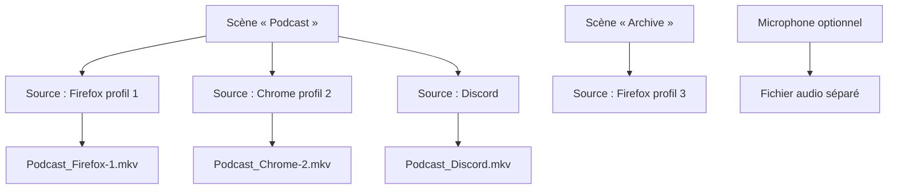
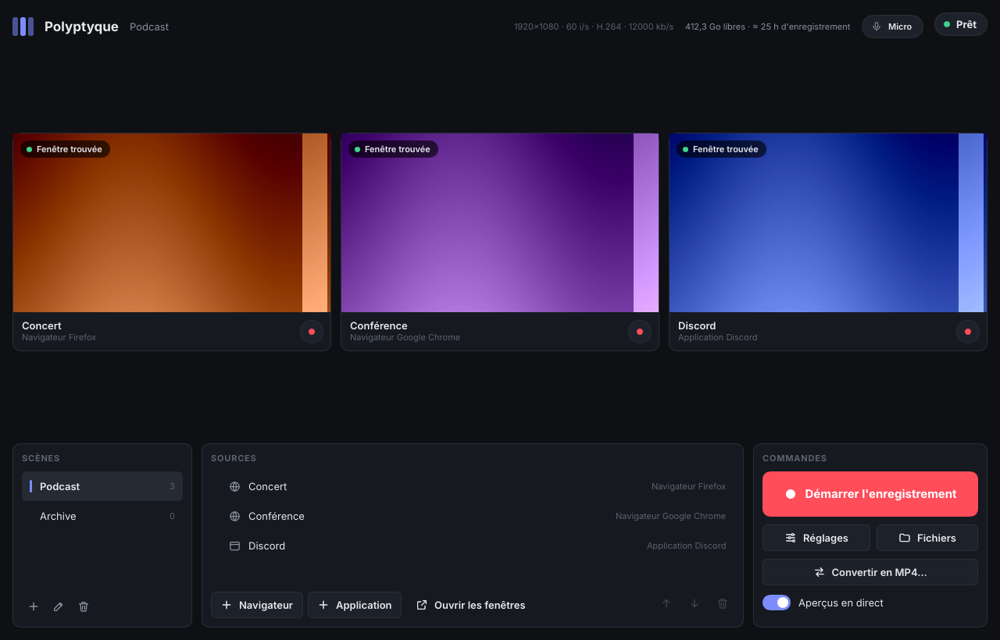
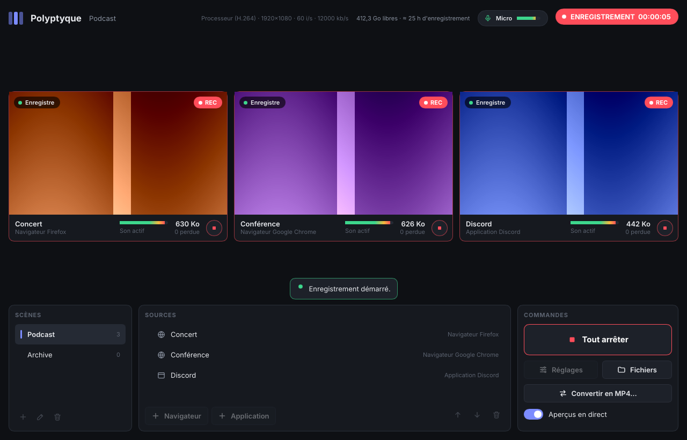
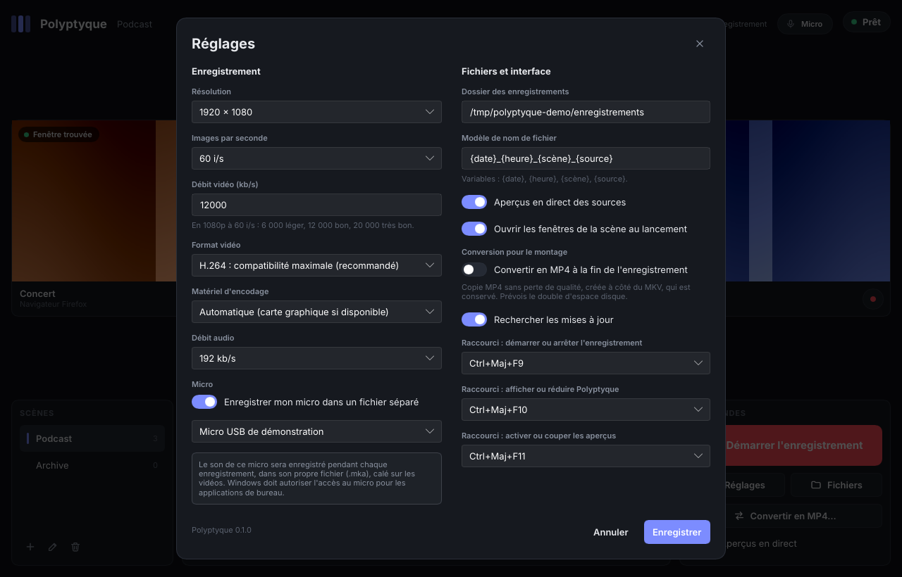
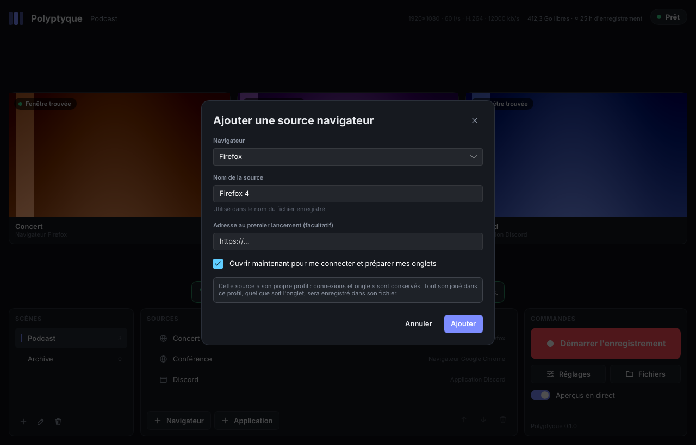
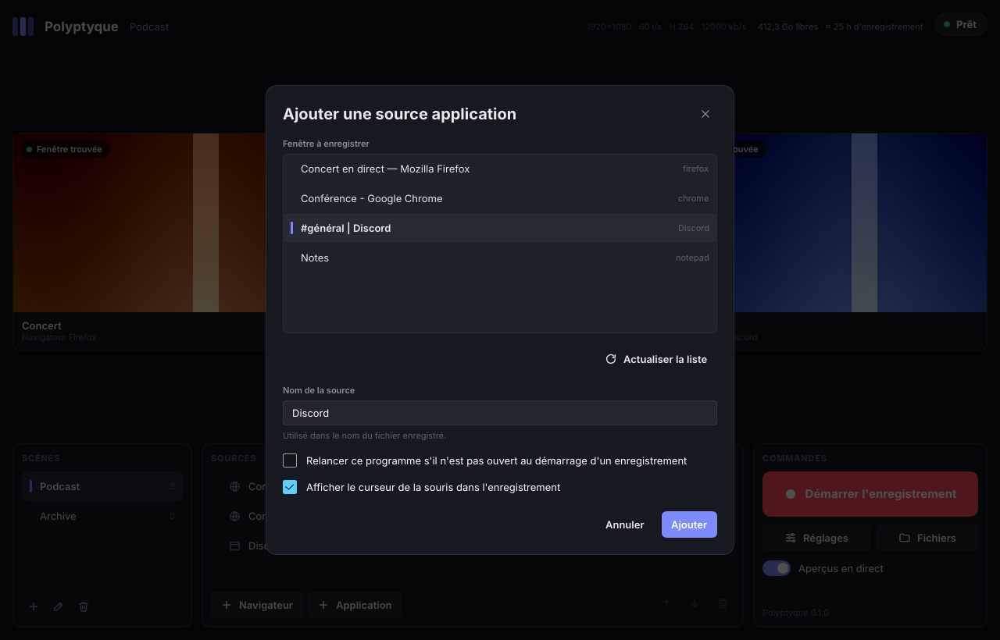
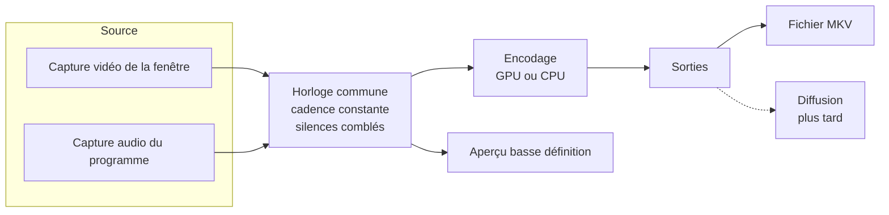

# Polyptyque - Cahier des charges

> [!abstract] Résumé
> Polyptyque est un logiciel d'enregistrement multi-sources. Il capture en même temps plusieurs fenêtres (navigateurs, applications, jeux) et enregistre chacune, avec **son propre son isolé**, dans un **fichier MKV distinct**.
> Usages visés : montage multi-angle et archivage, sur des sessions pouvant durer **jusqu'à 12 heures**.
> Plateforme : Windows d'abord, architecture prévue dès le départ pour un portage macOS et Linux.
> Priorité absolue : **fiabilité**, puis performance, puis simplicité d'usage.

## Table des matières

1. [[#Contexte et objectifs]]
	1. [[#Besoin]]
	2. [[#Priorités]]
2. [[#Périmètre]]
	1. [[#Inclus dans la version 1]]
	2. [[#Exclus de la version 1]]
3. [[#Concepts]]
4. [[#Exigences fonctionnelles]]
	1. [[#Scènes]]
	2. [[#Sources navigateur]]
	3. [[#Sources application]]
	4. [[#Reconnaissance et restauration des fenêtres]]
	5. [[#Enregistrement]]
	6. [[#Microphone]]
	7. [[#Fichiers de sortie et nommage]]
	8. [[#Conversion MKV vers MP4]]
	9. [[#Réglages d'encodage]]
	10. [[#Interface]]
	11. [[#Raccourcis clavier]]
	12. [[#Préparation de la diffusion en direct]]
	13. [[#Installation]]
5. [[#Exigences non fonctionnelles]]
	1. [[#Fiabilité]]
	2. [[#Performance]]
	3. [[#Compatibilité]]
	4. [[#Sécurité et vie privée]]
	5. [[#Distribution et licence]]
6. [[#Limites connues]]
7. [[#Architecture technique]]
	1. [[#Chaîne de traitement]]
	2. [[#Découpage du code]]
	3. [[#Technologies]]
	4. [[#Portage macOS et Linux]]
8. [[#Feuille de route]]
9. [[#Journal des décisions]]
10. [[#Questions ouvertes]]
11. [[#Sources]]

---

## Contexte et objectifs

### Besoin

[[OBS Studio]] n'enregistre qu'**un seul fichier à la fois** : toutes les sources sont mélangées dans une seule image et un seul son. Le besoin est l'inverse :

- capturer plusieurs fenêtres en parallèle (par exemple trois fenêtres de navigateur) ;
- produire **un fichier par fenêtre** ;
- dans chaque fichier, **uniquement le son émis par cette fenêtre**, ni le son du système, ni celui des autres fenêtres.

Les fenêtres capturées doivent être **reconnues de façon fiable** d'une session à l'autre, et rouvertes automatiquement si elles ne le sont pas.

### Priorités

| Rang | Priorité | Traduction concrète |
|---|---|---|
| 1 | Fiabilité | 12 h d'enregistrement sans perte, fichiers toujours lisibles, même après un plantage |
| 2 | Performance | Encodage par la carte graphique dès que possible, impact minimal sur la machine |
| 3 | Simplicité | Interface proche d'[[OBS Studio]] mais allégée, centrée sur le multi-enregistrement |
| 4 | Compatibilité | Fonctionner sur le plus grand nombre de machines Windows, avec dégradation propre |

---

## Périmètre

### Inclus dans la version 1

- Sources de type **navigateur géré** (profil dédié par source) et **application** (fenêtre quelconque).
- Plusieurs **scènes**, au sens de groupes de sources, verrouillées pendant l'enregistrement.
- Un **fichier MKV par source**, vidéo et son dans le même fichier.
- **Microphone** optionnel, enregistré dans un fichier séparé.
- **Conversion MKV vers MP4** sans perte.
- **Aperçu en direct** de toutes les sources en même temps.
- Réglages d'encodage, nommage des fichiers, raccourcis clavier.

### Exclus de la version 1

> [!info] Hors périmètre, mais anticipé
> - **Diffusion en direct** (streaming) : non développée, mais l'architecture est prévue pour l'ajouter plus tard. Si elle est ajoutée, elle sera gratuite.
> - **Portage macOS et Linux** : seul le module de capture sera à réécrire (voir [[#Portage macOS et Linux]]).

> [!failure] Abandonné
> - **Transitions et fichier « programme »** à la façon d'OBS : abandonnés. Dans Polyptyque, chaque source a son propre fichier, une transition entre scènes n'y aurait aucun sens.
> - **Composition** (placer et redimensionner plusieurs sources dans une même image) : abandonnée pour la même raison.
> - **Navigateur intégré** : écarté. Il ne couvrirait ni Discord, ni les jeux, ni Tor. Il imposerait de maintenir un moteur de navigation à jour (sécurité) et ferait perdre à l'utilisateur ses navigateurs, extensions et gestionnaires de mots de passe.
> - **Extension de navigateur** : écartée. La capture audio par onglet n'existe que sous Chromium, pas sous Firefox.

---

## Concepts



| Concept | Définition |
|---|---|
| **Scène** | Groupe nommé de sources, correspondant à un usage (« Podcast », « Archive »…). Une seule scène est active à la fois. |
| **Source** | Une fenêtre capturée avec son son isolé. Produit un fichier. |
| **Source navigateur** | Navigateur lancé par Polyptyque avec un profil qui lui est dédié. |
| **Source application** | Toute autre fenêtre : Discord, jeu, Tor Browser, logiciel quelconque. |
| **Profil dédié** | Dossier de profil de navigateur propre à une source. Il conserve connexions, cookies et onglets. |
| **Enregistrement** | Période pendant laquelle les sources de la scène active écrivent leurs fichiers. |

---

## Exigences fonctionnelles

### Scènes

- Créer, renommer, dupliquer, supprimer des scènes.
- Une scène contient une liste ordonnée de sources.
- **Verrouillage pendant l'enregistrement** : tant qu'au moins une source enregistre, il est impossible de :
	- changer de scène ;
	- ajouter ou supprimer une source ;
	- modifier les réglages d'encodage.
- La scène active à la fermeture est rouverte au lancement suivant.

### Sources navigateur

- **Détection des navigateurs installés** via la liste tenue par Windows (registre `StartMenuInternet`), plus la possibilité d'indiquer un exécutable à la main.
- **Choix du navigateur** à la création de chaque source.
- Familles gérées (chaque navigateur sera vérifié individuellement) :

| Famille | Exemples | Lancement avec profil dédié |
|---|---|---|
| Gecko (Firefox) | Firefox, LibreWolf, Waterfox, Zen, Floorp | `-profile "<dossier>" -no-remote` |
| Chromium | Chrome, Edge, Brave, Vivaldi, Opera | `--user-data-dir="<dossier>"` |

- **Un profil dédié par source**, stocké dans le dossier de données de Polyptyque (`%LOCALAPPDATA%\Polyptyque\profils\<identifiant>`).
- **Connexions conservées** : le profil est permanent, l'utilisateur ne se connecte qu'une fois par profil.
- **Restauration des onglets** : Polyptyque configure le profil pour rouvrir les onglets de la session précédente (Firefox : préférence `browser.startup.page = 3` ; Chromium : option de lancement `--restore-last-session`).
- **Adresse de départ** optionnelle, utilisée au premier lancement du profil.

> [!warning] Règle d'or des profils
> Le son est isolé **par profil**, pas par onglet. Tout son joué dans n'importe quel onglet ou fenêtre d'un profil se retrouve dans le fichier de la source correspondante. Une source = un profil = uniquement ce qui doit être entendu.

> [!note] Tor Browser
> Tor Browser est traité comme une **source application** : capture de sa fenêtre et de son son (isolé, car il tourne comme un programme séparé), **sans** profil géré ni connexion conservée. C'est le fonctionnement voulu par Tor (effacement à la fermeture).

### Sources application

- Sélection d'une fenêtre ouverte dans une liste (titre, icône, nom du programme).
- Informations mémorisées : chemin de l'exécutable, classe de fenêtre, titre de la fenêtre, arguments de lancement éventuels.
- **Relance automatique** optionnelle, réglable par source (utile pour Discord, pas toujours souhaitable pour un jeu lancé depuis Steam).
- Option par source : afficher ou non le curseur de la souris (affiché par défaut).

### Reconnaissance et restauration des fenêtres

Au lancement de Polyptyque (réglage « Ouvrir les fenêtres de la scène au lancement », activé par défaut), avec le bouton « Ouvrir les fenêtres » du panneau des sources, et au démarrage d'un enregistrement, pour chaque source de la scène en cours (un changement de scène n'ouvre rien) :

1. **Source navigateur** : recherche du processus dont la ligne de commande contient le dossier du profil dédié. S'il existe, sa fenêtre principale est rattachée ; sinon, le navigateur est relancé avec ce profil.
2. **Source application** : recherche par ordre de précision décroissante :
	1. même exécutable, même classe et même titre ;
	2. même exécutable et même classe ;
	3. même exécutable, si une seule fenêtre correspond ;
	4. sinon : relance (si activée).
	
	En cas d'ambiguïté, la fenêtre utilisée le plus récemment est retenue, sans question (à revoir si des erreurs de reconnaissance apparaissent).
3. Chaque source affiche son état : **connectée**, **en attente**, **introuvable**.

> [!tip] Pourquoi c'est fiable pour les navigateurs
> L'identifiant d'une fenêtre change à chaque ouverture, et le titre d'une fenêtre de navigateur change avec l'onglet affiché. Le dossier de profil, lui, ne change jamais : c'est la clé de reconnaissance.

**Fermeture avec Polyptyque** (réglage « Fermer les navigateurs des sources en quittant », activé par défaut) : en quittant Polyptyque, toutes les fenêtres des profils dédiés, toutes scènes confondues, reçoivent une demande de fermeture, comme un clic sur leur croix. Le navigateur enregistre sa session (onglets rouverts au lancement suivant) et peut demander confirmation pour une page non enregistrée. Les applications ne sont jamais fermées, ni le navigateur personnel (autre profil, autre processus).
- Un navigateur ne rouvre que la **dernière fenêtre fermée** de son profil : la fenêtre de la source est fermée en dernier, les autres restent dans « Fenêtres récemment fermées ».
- Rien n'est fermé à la fermeture de la session Windows (Windows ferme lui-même les navigateurs, s'en mêler ferait perdre des fenêtres), ni au redémarrage pour une mise à jour, ni après un plantage.

### Enregistrement

- **Bouton global** : démarre toutes les sources de la scène active **au même instant**, sur une **horloge commune**.
- **Enregistrement individuel** : chaque source peut aussi être démarrée ou arrêtée seule, par le bouton de sa carte.
	- Hors enregistrement, le bouton d'une carte démarre cette seule source.
	- Pendant un enregistrement, une source arrêtée est finalisée en arrière-plan pendant que les autres continuent ; une source ajoutée en cours de route commence un **nouveau fichier**, nommé d'après son heure de départ.
	- Arrêter la dernière source termine l'enregistrement. Le bouton principal devient « Tout arrêter ».
- **Cadence constante** : Windows n'envoie une image que lorsque la fenêtre change ; Polyptyque répète la dernière image pour garantir une cadence fixe (indispensable aux logiciels de montage).
- **Son continu** : les silences sont comblés pour que le son reste calé sur l'image.
- **Fenêtre perdue** (fermée, plantée) : le fichier continue avec une **image noire et du silence** ; la source est **rattachée automatiquement** dès que la fenêtre réapparaît.
	- Bouton **« Rouvrir la fenêtre »** sur la carte, y compris pendant l'enregistrement.
	- **Réouverture automatique** après 20 s pour les navigateurs et les applications dont la relance est activée : trois essais par disparition, dix par enregistrement. Firefox encore en train de se fermer ou de redémarrer n'est pas relancé (il afficherait « Firefox est déjà ouvert »).
- **Fenêtre réduite** : Windows ne la dessine plus, l'image se fige ; un avertissement s'affiche, avec un bouton **« Rétablir la fenêtre »** qui la fait revenir sans lui donner le focus et la replace sur l'écran principal si elle n'est plus sur aucun écran (écran débranché).
- **Fenêtre redimensionnée** : la résolution du fichier reste fixe, l'image est mise à l'échelle en conservant ses proportions, avec des bandes noires si besoin.
- **Mise en veille automatique de Windows empêchée** pendant l'enregistrement. Une mise en veille demandée (capot, bouton, menu) ne peut pas l'être : Windows prévient quelques secondes avant, l'enregistrement est arrêté proprement, et sa reprise est proposée au réveil (voir B3 dans l'[[analyse-des-risques|analyse des risques]]).
- **Encodeur de la carte graphique refusé** (limite d'encodages simultanés des cartes GeForce, autres logiciels compris ; pilote) : la source passe seule sur le processeur, dans une nouvelle partie, avec un message.
- **Encodeur arrêté ou figé** (plantage de FFmpeg, pilote, 30 s sans avancer) : la capture continue et un nouvel encodeur reprend dans un nouveau fichier `…_partie2.mkv`, image et son recalés au même instant. Trois échecs d'affilée dès le démarrage arrêtent la source, pour ne pas tourner en boucle.
- **Dossier d'enregistrement inaccessible** (disque externe débranché, autre PC) : au démarrage comme en cours de route, la suite est enregistrée dans `Vidéos\Polyptyque`, avec un message.
- **Erreur interne** dans la capture d'une source : la capture est relancée au même point de l'horloge (image et son restent calés) ; au-delà de trois relances, la source passe en erreur, sans toucher aux autres.
- **Enregistrement interrompu** (plantage, coupure de courant, écran bleu) : au lancement suivant, une fenêtre « Enregistrement interrompu » fait le bilan des fichiers et propose de **réparer** ceux qui ont été coupés net (durée et index reconstruits sans réencodage, original remplacé après vérification) et de **reprendre l'enregistrement**.
- **Une seule copie** de Polyptyque à la fois : un second lancement ramène la fenêtre déjà ouverte.
- **Arrêt, redémarrage ou déconnexion de Windows** pendant un enregistrement : Polyptyque le signale à Windows, qui l'affiche dans son écran d'arrêt et permet d'annuler. Si l'arrêt continue malgré tout, les fichiers sont finalisés avant la fermeture. Un arrêt critique (batterie épuisée) n'est jamais bloqué.

### Microphone

- **Désactivé par défaut.**
- Activation dans les réglages, avec **demande de confirmation explicite** à l'utilisateur, en respectant les autorisations de confidentialité de Windows.
- Choix du périphérique d'entrée.
- Choix du micro par défaut de Windows ou d'un micro précis ; un micro choisi puis débranché reste mémorisé et proposé.
- Enregistré dans un **fichier audio séparé**, sur la même horloge que les vidéos, pendant toute la durée de l'enregistrement.
- Micro débranché puis rebranché : repris automatiquement (silence en attendant).
- Accès refusé par Windows (réglage de confidentialité) : détecté et expliqué, avec un raccourci vers le bon écran des Paramètres.
- **Test dans les réglages** : sous la liste des micros, un indicateur de niveau montre si le micro choisi capte du son (avant même d'enregistrer les réglages) ; une erreur d'accès s'y affiche directement. Le micro n'est écouté que pendant que les réglages sont ouverts avec le micro activé : jamais en permanence, pour que l'icône « micro utilisé » de Windows ne reste pas allumée.

> [!info] Format du fichier micro
> Pendant l'enregistrement : Matroska audio (`…_Micro.mka`, son AAC), avec la même robustesse que les vidéos. Le WAV classique était exclu : limité à 4 Go, soit environ 6 h en stéréo 48 kHz 16 bits.
> Pour le montage : la conversion produit un `.m4a`, lu par la plupart des logiciels de montage.

### Fichiers de sortie et nommage

- **Un fichier MKV par source**, vidéo et son dans le même fichier.
- **Dossier de sortie** configurable.
- **Nom de chaque source** défini par l'utilisateur.
- **Modèle de nom commun**, avec variables :

| Variable | Exemple |
|---|---|
| `{date}` | `2026-10-20` |
| `{heure}` | `14h32` |
| `{scène}` | `Podcast` |
| `{source}` | `Discord` |

- Modèle par défaut : `{date}_{heure}_{scène}_{source}` → `2026-10-20_14h32_Podcast_Discord.mkv`
- **Aucun écrasement** : si le fichier existe, un suffixe numérique est ajouté.
- Après une relance de l'encodeur, la suite est dans `…_partie2.mkv`, `…_partie3.mkv`, etc. Le titre inscrit dans le fichier indique le moment de la reprise.
- Le micro est enregistré dans `…_Micro.mka` (variable `{source}` remplacée par « Micro »).
- **Découpage automatique** optionnel (toutes les N heures ou N Go), désactivé par défaut.

### Conversion MKV vers MP4

Le MKV est utilisé pendant l'enregistrement pour sa robustesse : un fichier MKV interrompu reste lisible, un MP4 interrompu est souvent perdu. Certains logiciels de montage ([[Premiere Pro]] notamment) gèrent mal le MKV, d'où une fonction de conversion.

- **Conversion sans réencodage** (« remuxage ») : les données vidéo et audio sont recopiées telles quelles dans un conteneur MP4. Aucune perte de qualité, opération rapide.
- Déclenchement :
	- **manuel** : sélection d'un ou plusieurs fichiers ;
	- **automatique** (option) : conversion à la fin de chaque enregistrement, en conservant le MKV d'origine.
- Vérification de la conversion (durée, pistes) avant de la déclarer réussie ; en cas d'échec ou d'annulation, le fichier partiel est effacé.
- Les fichiers de son seul (`.mka`) sont convertis en `.m4a` ; le HEVC reçoit l'étiquette `hvc1` attendue par la plupart des logiciels.
- Espace disque vérifié avant chaque fichier (la copie double la place occupée).
- Conversion en arrière-plan, un fichier à la fois : une pastille indique l'avancement, un clic permet d'annuler, et un enregistrement peut démarrer pendant ce temps.

> [!warning] À vérifier en test
> Certains utilisateurs signalent des craquements audio après un remuxage. La conversion devra être validée sur de longs fichiers, dans [[Premiere Pro]] et [[DaVinci Resolve]].

### Réglages d'encodage

Réglages **communs à toutes les sources** dans la version 1.

| Réglage | Valeurs | Défaut |
|---|---|---|
| Matériel d'encodage | Automatique, carte graphique (GPU), processeur (CPU) | Automatique (GPU si disponible) |
| Encodeur | Détecté : NVIDIA NVENC, AMD AMF, Intel Quick Sync, logiciel | Le meilleur disponible |
| Codec | H.264, HEVC (selon le matériel) | H.264 (compatibilité maximale au montage) |
| Résolution | 720p, 1080p, 1440p, 2160p, personnalisée | 1080p |
| Images par seconde | 24, 25, 30, 50, 60, personnalisé | 60 |
| Contrôle du débit | Débit constant (CBR), débit variable (VBR), qualité constante | À définir |
| Débit vidéo | En kb/s | À définir après mesures (piste : 12 000 kb/s en 1080p60) |
| Préréglage | Vitesse ↔ qualité | Équilibré |
| Audio | AAC 48 kHz stéréo, débit en kb/s | 192 kb/s |

> [!info] Estimation d'espace disque
> À 12 000 kb/s, une source occupe environ **5,4 Go par heure**, soit environ **65 Go en 12 h** ; trois sources occupent environ **195 Go**.

### Interface

Inspirée d'[[OBS Studio]], volontairement allégée, thème sombre.

> [!important] Exigences de conception
> - **Légèreté** : l'interface ne doit pas alourdir le logiciel. Pas de page web embarquée ; une interface native dessinée par la carte graphique.
> - **Épurée et esthétique** : peu d'éléments à l'écran, hiérarchie claire.
> - **Facilement remplaçable** : l'apparence est décrite dans des fichiers séparés de la logique, et l'interface ne communique avec le moteur que par une interface de programmation unique (démarrer, suivre, arrêter). Changer l'apparence, voire toute l'interface, ne touche pas au moteur.

```text
┌────────────────────────────────────────────────────────────┐
│ Polyptyque                               ● REC  02:14:37   │
├────────────────────────────────────────────────────────────┤
│ ┌───────────────┐  ┌───────────────┐  ┌───────────────┐    │
│ │   Source 1    │  │   Source 2    │  │    Discord    │    │
│ │   (aperçu)    │  │   (aperçu)    │  │   (aperçu)    │    │
│ │ ● 60 i/s ▮▮▮▯ │  │ ● 60 i/s ▮▮▯▯ │  │ ● 60 i/s ▮▯▯▯ │    │
│ └───────────────┘  └───────────────┘  └───────────────┘    │
├──────────────┬────────────────────┬────────────────────────┤
│ Scènes       │ Sources            │ Commandes              │
│ > Podcast    │  Source 1 (Firefox)│ [ Démarrer tout ]      │
│   Archive    │  Source 2 (Chrome) │ [ Paramètres ]         │
│              │  Discord           │ Disque : 412 Go libres │
│ [+] [-]      │ [+] [-] [⚙]        │ ≈ 31 h restantes       │
└──────────────┴────────────────────┴────────────────────────┘
```

- **Grille d'aperçus** de toutes les sources de la scène, en basse définition pour ne pas pénaliser l'enregistrement, désactivable. Chaque aperçu a sa propre capture, indépendante de l'enregistrement (environ 10 images par seconde) : il fonctionne aussi hors enregistrement. Sa définition suit la taille réelle des cartes à l'écran : 640 × 360 au minimum, 960 × 540 ou 1280 × 720 pour de grandes cartes. Les fichiers enregistrés ne sont jamais concernés.

> [!example]- Captures de l'interface (mode démonstration)
> 
> 
> 
> 
> 
- Par source : nom, état, cadence réelle, indicateur de niveau sonore, durée, taille du fichier, bouton d'enregistrement individuel.
- Niveau sonore affiché **en permanence**, pas seulement pendant l'enregistrement : chaque source écoute le son de son programme (même capture que l'enregistrement, seule la crête est gardée). Dès que le moteur écoute la source (enregistrement, préparation, finalisation), cette écoute s'arrête et la carte affiche le niveau du moteur. Indépendant du réglage des aperçus.
- Barre du haut : pastille du micro (avec son niveau pendant l'enregistrement) et pastille de la conversion MP4 en cours.
- **Barre d'état** : espace disque libre, autonomie estimée, charge processeur et carte graphique, images perdues.
- **Fenêtre de paramètres** : Sortie, Encodage, Audio, Raccourcis, Général.
- Langue : français au départ, textes externalisés pour permettre la traduction (public visé : grand public).
- Accessibilité : navigation complète au clavier, compatibilité lecteur d'écran selon la technologie d'interface retenue.

> [!todo] Pas encore réalisé (constat du 2026-10-22)
> Comparaison de ce cahier avec le code, pour ne rien oublier :
> - duplication d'une scène ;
> - cadence réelle et durée sur chaque carte ; charge du processeur et de la carte graphique dans la barre d'état ;
> - fenêtre de paramètres en sections (aujourd'hui : une feuille en deux colonnes « Enregistrement » et « Fichiers et interface ») ;
> - textes externalisés pour la traduction ; navigation complète au clavier ;
> - réglages d'encodage : résolution et cadence personnalisées depuis l'interface, contrôle du débit (débit constant imposé aujourd'hui), préréglage, choix d'un encodeur précis, codecs proposés selon le matériel ;
> - découpage automatique (toutes les N heures ou N Go) ;
> - alertes de disque par paliers et avertissement avant le démarrage ;
> - test de capacité d'encodage au démarrage (aujourd'hui : l'encodeur est seulement essayé) ;
> - modification d'une source après sa création (relance, curseur, arguments de lancement).

### Raccourcis clavier

- **Globaux** : actifs même quand Polyptyque est en arrière-plan.
- **Tous configurables**, avec quelques propositions par défaut :

| Action | Proposition |
|---|---|
| Démarrer / arrêter tout | <kbd>Ctrl</kbd> + <kbd>Maj</kbd> + <kbd>F9</kbd> |
| Afficher / réduire Polyptyque | <kbd>Ctrl</kbd> + <kbd>Maj</kbd> + <kbd>F10</kbd> |
| Activer / couper les aperçus | <kbd>Ctrl</kbd> + <kbd>Maj</kbd> + <kbd>F11</kbd> |

> [!tip] Pourquoi pas Ctrl + Alt
> Sur un clavier AZERTY, <kbd>Ctrl</kbd> + <kbd>Alt</kbd> équivaut à <kbd>AltGr</kbd> : ces combinaisons entreraient en conflit avec la saisie de caractères (€, @, #…).

### Préparation de la diffusion en direct

Non développée en version 1. L'architecture sépare **l'encodage** de **la destination** : chaque flux encodé est envoyé vers une ou plusieurs « sorties ». Seule la sortie « fichier » existe en version 1 ; une sortie « diffusion » (RTMP, SRT) pourra être ajoutée sans refonte.

### Installation

> [!important] Exigences
> - **Un seul fichier `.exe`**, le plus autonome possible.
> - **Aucune question** sauf nécessité réelle.
> - Clair, simple et **agréable visuellement**.
> - Priorité forte en cas de publication.

Solution retenue : **[[Velopack]]** (outil d'installation et de mise à jour écrit en Rust, licence MIT, maintenu activement).

| Point | Comportement |
|---|---|
| Fichier livré | Un seul `Polyptyque-Setup.exe` |
| Questions posées | Aucune : installation dans le dossier de l'utilisateur, puis lancement de Polyptyque |
| Droits administrateur | Non requis (pas d'alerte UAC) |
| Apparence | Animation d'accueil : les trois panneaux du logo s'allument tour à tour (`assets/logo/installation.gif`) |
| Raccourcis | Bureau et menu Démarrer |
| Dossier d'installation | `%LOCALAPPDATA%\PolyptyqueApp`, distinct des données (`%APPDATA%\Polyptyque`, `%LOCALAPPDATA%\Polyptyque`) : une désinstallation efface tout le dossier d'installation mais conserve scènes, réglages, profils de navigateur (connexions) et journaux |
| Système minimal | Windows 10 version 2004 ; refus avec explication en dessous |
| Version portable | `Polyptyque-portable.zip`, sans installation et autonome : scènes, réglages et leurs sauvegardes, profils de navigateur (connexions) et journaux dans le dossier `données` du dossier décompressé, rien d'écrit ailleurs sur le PC, pour tout emporter d'un ordinateur à l'autre. Les profils et les navigateurs sont retrouvés automatiquement après un déplacement. Les enregistrements restent dans le dossier choisi (repli sur `Vidéos\Polyptyque` s'il n'existe pas sur le nouvel ordinateur). Reconnue au marqueur `.portable` que Velopack place dans le zip ; les réglages affichent « portable » à côté du numéro de version |
| Mises à jour | Recherche au démarrage puis toutes les 6 h (désactivable) ; proposées d'un clic, téléchargées avec avancement, puis redémarrage ; jamais pendant un enregistrement ou une conversion (sinon installées au prochain démarrage). Source : publications GitHub du dépôt public |
| Publication | Étiquette `vX.Y.Z` (identique à la version de `Cargo.toml`) : la fabrication publie la version GitHub, avec mise à jour partielle depuis la précédente, notes de version obligatoires (`packaging/notes/vX.Y.Z.md`). Une bêta (`X.Y.Z-beta.N`) est publiée comme préversion GitHub |
| Liens de téléchargement | En tête du README, liens directs vers l'installateur et la version portable. Épinglés sur l'étiquette de la bêta en cours tant qu'aucune version stable n'existe (`releases/latest/download/` ignore les préversions et renvoie 404), donc à mettre à jour à chaque bêta. **À la sortie de la 1.0.0 stable : passer aux adresses `releases/latest/download/`**, qui suivent ensuite seules chaque version stable |
| Canaux | Réglage « Mises à jour » : versions stables, versions stables et bêta, ou ne pas rechercher. Tant que l'utilisateur n'a rien choisi, une bêta suit les bêtas puis la version stable, une version stable ne suit que les stables |
| Surcoût | Environ 7,5 Mo pour l'installateur, 5 Mo pour l'outil de mise à jour |
| macOS / Linux | Paquet `.pkg` sous macOS (fabriqué sur un Mac), AppImage auto-mise à jour sous Linux |

> [!note] Alternative écartée
> Inno Setup 7 propose un style moderne (clair/sombre) mais repose sur un assistant à plusieurs pages et n'a pas de mise à jour automatique.

---

## Exigences non fonctionnelles

### Fiabilité

- [x] Tenir **12 h** d'enregistrement continu avec plusieurs sources (validé le 2026-10-21 : 14 h 15 avec trois sources en 1280×720, 30 i/s ; la charge en 1080p60 reste à mesurer).
- [x] Fichiers MKV écrits au fil de l'eau, **lisibles même après un plantage** ou une coupure de courant (validé en simulation avec un FFmpeg tué ; un fichier coupé net est réparé sans réencodage).
- [x] **Désynchronisation** entre fichiers inférieure à une image (16 ms à 60 i/s) sur 12 h (mesuré le 2026-10-21 : après 14 h 15, les sons des trois fichiers se terminent à 2,4 ms près ; durées identiques).
- [x] **Isolation des pannes** : une source en échec n'interrompt jamais les autres (validé en simulation).
- [x] **Relance automatique** d'un encodeur arrêté ou figé, dans un nouveau fichier ; perte limitée à environ une seconde (fichiers écrits par blocs d'une seconde). Validé en simulation, avec un vrai plantage et un vrai blocage de FFmpeg.
- [ ] **Fermeture de session Windows** : arrêt bloqué avec explication, sinon fichiers finalisés avant la fermeture (réalisé, à tester sur la machine de référence).
- [ ] **Surveillance du disque** : estimation avant démarrage, alertes par paliers, arrêt propre (fichiers correctement fermés) si l'espace vient à manquer. Réalisé : estimation, un seuil d'alerte (texte orange sous 10 Go ou 1 h d'autonomie), arrêt propre sous 1 Go ; manquent les alertes par paliers et un avertissement avant le démarrage.
- [x] **Mémoire stable** sur 12 h (aucune fuite), vérifiée par des tests d'endurance (2026-10-21 : environ 415 Mo pour Polyptyque et 195 Mo par FFmpeg, sans croissance constatée).
- [x] **Journal technique** détaillé pour le diagnostic : un journal par lancement, un dossier par enregistrement (journal de chaque FFmpeg), bilan de fin par source.
- [ ] **Reprise après incident** : bilan, réparation et reprise au lancement suivant (réalisé le 2026-10-22, à tester sur la machine de référence).
- [ ] **Réglages protégés** : écriture forcée sur le disque, version précédente et une sauvegarde par jour (cinq jours), restauration automatique d'un fichier abîmé (réalisé le 2026-10-22, testé en simulation).

### Performance

- Chaîne **entièrement sur la carte graphique** quand c'est possible : capture, mise à l'échelle et encodage sans repasser par la mémoire centrale.
- Encodage par le processeur disponible en secours, ou sur choix de l'utilisateur.
- Aperçus en définition réduite (adaptée à la taille des cartes) et désactivables.
- Compteur d'images perdues par source.

### Compatibilité

| Élément | Exigence |
|---|---|
| Système | Windows 10 version 2004 ou plus récente, et Windows 11, 64 bits |
| Pilote NVIDIA | 570 ou plus récent avec FFmpeg 8.1 (FFmpeg 9 exigerait 610 ou plus) |
| Son isolé par programme | Windows 10 version 2004 ou plus récent (la documentation Microsoft indique la build 20348) |
| Bordure jaune de capture | Retirée quand Windows le permet (Windows 11) ; affichée sinon, sans contournement |
| Encodeurs | Détection au démarrage de NVENC, AMF, Quick Sync ; encodeur logiciel en secours |
| Limites d'encodage | Test au démarrage du nombre de flux encodables ; avertissement ou refus avant de dépasser la capacité |

> [!example] Machine de référence (tests)
> - Processeur : AMD Ryzen 7 5800X (sans partie graphique intégrée)
> - Carte graphique : NVIDIA RTX 3080 10 Go (une puce NVENC, H.264 et HEVC, **pas d'AV1 en encodage**)
> - Système : Windows 11

### Sécurité et vie privée

- Les profils de navigateur contiennent des **sessions connectées** : stockés uniquement en local, jamais transmis.
- Microphone désactivé par défaut, activation explicite.
- Aucune donnée envoyée sur Internet par Polyptyque (proposition, voir [[#Questions ouvertes]]). Seule exception : la recherche de mises à jour interroge GitHub (adresse IP visible de GitHub, rien d'autre), désactivable dans les réglages.

### Distribution et licence

- **Gratuit.**
- **Code source ouvert**, licence **GPL v3 ou ultérieure**. Imposée de fait par FFmpeg compilé avec l'encodeur x264 (meilleur encodeur par le processeur), elle a été acceptée.
- **Pas de signature numérique payante.**

> [!warning] Conséquences de l'absence de signature
> - **SmartScreen** : au téléchargement, Windows affiche « Windows a protégé votre ordinateur ». L'utilisateur doit cliquer sur « Informations complémentaires » puis « Exécuter quand même ». Chaque nouvelle version repart de zéro en réputation.
> - **Smart App Control** (Windows 11) : quand il est actif, il **bloque totalement** les programmes non signés, sans contournement possible pour un programme isolé ; il faudrait désactiver la fonction. Cela concerne aussi `ffmpeg.exe` et l'outil de mise à jour.

> [!tip] Piste gratuite : SignPath Foundation
> [SignPath Foundation](https://signpath.org/) signe **gratuitement** les projets open source (environ 330 projets, dont Vim et VSCodium). Conditions principales : licence reconnue par l'OSI sans double licence commerciale, projet maintenu et **déjà publié**, fabrication vérifiable depuis le code source (GitHub Actions), double authentification pour l'équipe, page de politique de signature. Le certificat est au nom de la fondation.
> Points à traiter : pas d'intégration officielle avec Velopack (script de signature à écrire) ; `ffmpeg.exe` devra être compilé par le projet pour être signé.
> Option payante de repli : certificat Certum « Open Source Developer », à partir de 69 €.

---

## Limites connues

| Limite | Cause | Conséquence ou contournement |
|---|---|---|
| Son isolé par programme, pas par fenêtre | Fonctionnement de Windows | Un profil de navigateur dédié par source |
| Tous les onglets d'un profil partagent le son | Un profil = un programme | Ne garder dans un profil que ce qui doit être entendu |
| Fenêtre réduite = image figée | Windows ne dessine plus une fenêtre réduite | Garder les fenêtres ouvertes, même cachées derrière d'autres |
| Contenus protégés (Netflix, Disney+…) souvent noirs | Protection anticopie | Aucun contournement prévu |
| Certains jeux en plein écran exclusif donnent une image noire | Mode d'affichage du jeu | Utiliser le mode « fenêtré sans bordure » |
| Son joué par un autre programme que celui de la fenêtre | Architecture de certains logiciels | Avertissement affiché ; son non capturé |
| Tor Browser ne conserve pas les connexions | Choix de conception de Tor | Accepté |
| Certains sites déconnectent après un délai | Politique des sites | Hors de contrôle |
| Bordure jaune sur Windows 10 | Pas de méthode pour la retirer | Accepté |
| AV1 indisponible sur RTX 30 | Matériel | Codecs proposés selon la carte détectée |
| Plantage de l'encodeur : environ une seconde perdue | Données encore en mémoire dans FFmpeg | La suite est dans `…_partie2.mkv`, à placer au montage à la suite de la première partie |
| Arrêt forcé de Windows sans délai | Windows peut fermer Polyptyque sans attendre | Fichiers MKV lisibles quand même ; au plus une seconde perdue |
| Pas de protection contre l'arrêt de Windows dans la console | Seule l'interface graphique a une fenêtre pour la recevoir | Utiliser l'interface graphique |

> [!bug] Point à surveiller
> Des utilisateurs d'OBS signalent que la capture audio d'un navigateur échoue selon qu'il a été ouvert avant ou après le logiciel de capture. Comme Polyptyque lance lui-même les navigateurs, le risque est réduit, mais il sera testé explicitement.

---

## Architecture technique

### Chaîne de traitement



### Découpage du code

Le code est organisé en modules indépendants (« crates » Rust) :

| Module | Rôle | Dépend du système |
|---|---|---|
| `polyptyque-core` | Scènes, sources, réglages, sauvegarde, nommage, calculs de synchronisation, commandes FFmpeg, et le contrat `Platform` que chaque système doit remplir | Non |
| `polyptyque-windows` | Implémentation Windows de `Platform` : capture d'image et de son, fenêtres, processus, navigateurs installés, tubes | **Oui** |
| `polyptyque-engine` | Sessions d'enregistrement : fils de capture, horloge commune, encodeurs, arrêt propre | Non |
| `polyptyque-app` | Interface graphique [[Slint]] : apparence dans `ui/` (thème dans `ui/theme.slint`), logique dans `src/` ; mode démonstration hors Windows | Non (raccourcis et arrêt de Windows : oui) |
| `polyptyque-cli` | Prototype en console (étape 0), livré à côté de l'interface pour le diagnostic | Non |

La session simulée (`polyptyque-engine/tests`) rejoue des enregistrements complets avec de fausses fenêtres, un faux micro et un vrai FFmpeg, sur n'importe quel système. Elle vérifie à chaque modification les durées et la synchronisation des fichiers produits, la conversion MP4, l'enregistrement individuel et la reprise après un **plantage réel de FFmpeg** en cours d'enregistrement.

### Technologies

| Besoin | Choix | Remarque |
|---|---|---|
| Langage | [[Rust]] | Rapide, sûr en mémoire, adapté aux traitements longs |
| Accès à Windows | Crate officielle Microsoft `windows` | |
| Capture vidéo | Windows.Graphics.Capture | Capture par fenêtre, même cachée derrière d'autres |
| Capture audio | WASAPI « process loopback », mode arbre de processus ; WASAPI classique pour le micro | Son d'un programme et de ses sous-programmes |
| Encodage et MKV | [[FFmpeg]] 8.1 (version GPL) : un processus par source, alimenté par deux tubes nommés (image NV12, son flottant), surveillé et relancé si besoin | NVENC, AMF, Quick Sync, x264 ; une panne d'encodeur n'affecte qu'une source |
| Conversion MP4 | [[FFmpeg]] en recopie sans réencodage (`-c copy`) | Vérification des pistes et de la durée |
| Fermeture de session | `ShutdownBlockReasonCreate`, messages `WM_QUERYENDSESSION` et `WM_ENDSESSION` sur la fenêtre principale | |
| Conversion d'image | Processeur vidéo Direct3D 11 de la carte graphique | Mise à l'échelle et conversion NV12 BT.709 sans passer par le processeur |
| Interface | [[Slint]] | Apparence décrite dans des fichiers `.slint` séparés de la logique ; compatible GPL v3 ; accessibilité via AccessKit ; aperçus par tampons d'image |
| Installateur | [[Velopack]] | Un seul `Polyptyque-Setup.exe`, sans question, mises à jour automatiques |
| Sauvegarde des scènes | Fichier de configuration dans `%APPDATA%\Polyptyque` | |
| Fabrication des exécutables | GitHub Actions sur machine Windows (fabrication seule) | Vérification du code et tests en local, sous Windows, avant chaque publication |

### Portage macOS et Linux

Seule une implémentation de `Platform` est à écrire pour chaque système (`polyptyque-macos`, `polyptyque-linux`). Pistes à étudier le moment venu : ScreenCaptureKit sous macOS, PipeWire sous Linux. L'isolation du son par programme y sera à revérifier.

---

## Feuille de route

> [!todo] Étape 0 - Prototype (moteur et console), écrit le 2026-10-20
> - [x] Moteur : capture, horloge commune, cadence constante, encodage, MKV (validé en simulation)
> - [x] Fenêtres perdues et rattachement automatique, surveillance du disque, anti-veille, journaux
> - [x] Navigateurs gérés : détection, profils dédiés, lancement, restauration des onglets, reconnaissance
> - [x] Validation sur la machine de référence : capture, encodage NVENC, plusieurs réglages de qualité
> - [x] Validation sur la machine de référence : **son isolé par profil de navigateur**
> - [x] Validation sur la machine de référence : pas de bordure jaune (autorisation de Windows accordée)
> - [ ] Validation sur la machine de référence : Discord
> - [ ] Nombre de flux 1080p60 encodables en parallèle sur la RTX 3080
> - [x] Test d'endurance de 1 h, puis de 12 h ; vérification de la synchronisation et de la lisibilité des fichiers (14 h 15 le 2026-10-21)

> [!todo] Étape 1 - Robustesse du moteur, écrite le 2026-10-20
> - [x] Aperçus plus nets, définition adaptée à la taille des cartes
> - [x] Relance automatique d'un encodeur arrêté ou figé (nouvelle partie de fichier), fichiers écrits par blocs d'une seconde
> - [x] Enregistrement individuel d'une source
> - [x] Micro optionnel dans un fichier séparé
> - [x] Conversion MKV vers MP4 sans perte (manuelle et automatique)
> - [x] Protection contre l'arrêt ou la déconnexion de Windows
> - [ ] Validation sur la machine de référence

> [!todo] Étape 2 - Interface graphique ([[Slint]]), écrite le 2026-10-20
> - [x] Scènes, sources, grille d'aperçus en direct, réglages, nommage
> - [x] Verrouillage pendant l'enregistrement, raccourcis globaux réglables
> - [x] Mode démonstration hors Windows (fausses fenêtres) pour développer et vérifier l'interface
> - [ ] Validation sur la machine de référence

> [!todo] Étape 3 - Installateur ([[Velopack]]), écrite le 2026-10-20
> - [x] Logo et icône (variante « carré coloré »), intégrés aux exécutables
> - [x] `Setup.exe` unique avec animation d'accueil, version portable
> - [x] Mises à jour proposées depuis les publications GitHub
> - [x] README complet
> - [ ] Validation sur la machine de référence
> - [x] Version portable autonome (tout dans son dossier `données`)
> - [x] Bouton « Rétablir la fenêtre » sur une carte « Réduite » : la fenêtre revient et se replace sur un écran branché (cas vu en test : écran débranché pendant l'enregistrement)
> - [ ] Validation de la version portable et de l'installateur sur la machine de référence

> [!todo] Étape 3 bis - Reprise après incident (lot 1 de l'[[analyse-des-risques|analyse des risques]]), écrite le 2026-10-22
> - [x] Journal de session, bilan d'un enregistrement interrompu, réparation sans réencodage, reprise
> - [x] Fils de capture protégés, instance unique, réglages sauvegardés, dossier de secours
> - [x] Boutons « Rouvrir la fenêtre » pendant l'enregistrement, réouverture automatique
> - [x] Conversion MP4 sous un nom temporaire jusqu'à sa vérification (A6, avancé du lot 2)
> - [x] Journal : passages en « Réduite », bilan de fin par source ; son déclaré stéréo à FFmpeg
> - [x] Lot 2 et 3 avancés : mise en veille (arrêt propre, reprise proposée), relance par Windows après un redémarrage, bascule sur le processeur, journaux de plus de 30 jours effacés
> - [ ] Validation sur la machine de référence

> [!todo] Étape 4 - Publication
> - [ ] Dépôt public, première version publiée
> - [ ] FFmpeg compilé par le projet (plus léger, signable)
> - [ ] Demande de signature gratuite à SignPath Foundation
> - [ ] Tests d'endurance de 12 h complets (un premier test de 14 h 15 réussi le 2026-10-21 en 1280×720, 30 i/s ; à refaire avec les réglages par défaut, 1920×1080 et 60 i/s)

> [!info] Plus tard
> - Diffusion en direct (gratuite)
> - Portage macOS, puis Linux
> - Réglages d'encodage par source
> - Chemin « zéro copie » : encodage directement depuis la mémoire de la carte graphique

---

## Journal des décisions

| Date | Décision |
|---|---|
| 2026-10-20 | Développement en [[Rust]], Windows d'abord, architecture multi-systèmes |
| 2026-10-20 | Son isolé obtenu par **un profil de navigateur dédié par source**, lancé par Polyptyque |
| 2026-10-20 | Pas de navigateur intégré, pas d'extension de navigateur |
| 2026-10-20 | Scènes = groupes de sources, **verrouillées pendant l'enregistrement** ; pas de transitions ni de composition |
| 2026-10-20 | Tor Browser traité comme une application, sans connexion conservée |
| 2026-10-20 | Fenêtre perdue : image noire et silence, rattachement automatique |
| 2026-10-20 | MKV pendant l'enregistrement, conversion MP4 sans perte en option |
| 2026-10-20 | Défauts : 1080p, 60 i/s, H.264, encodage GPU si disponible, choix GPU ou CPU laissé à l'utilisateur |
| 2026-10-20 | Bordure jaune retirée sous Windows 11 uniquement, sans contournement ailleurs |
| 2026-10-20 | Microphone optionnel, désactivé par défaut, fichier séparé |
| 2026-10-20 | Bouton d'enregistrement global et enregistrement individuel par source |
| 2026-10-20 | Diffusion en direct hors version 1, architecture prête, gratuite si ajoutée |
| 2026-10-20 | Modèle de nom par défaut : `{date}_{heure}_{scène}_{source}` |
| 2026-10-20 | Logiciel **gratuit**, **open source**, licence GPL v3 ou ultérieure |
| 2026-10-20 | Pas de signature payante ; piste SignPath Foundation (gratuite) à la publication |
| 2026-10-20 | Installateur : un seul `.exe`, sans question, agréable → **[[Velopack]]**, validé |
| 2026-10-20 | Interface légère, épurée, facilement remplaçable → **[[Slint]]**, validé |
| 2026-10-20 | Encodage par un processus FFmpeg 8.1 par source (pilotes NVIDIA 570+) |
| 2026-10-20 | Branches : `dev` pour le travail en cours, `main` pour les versions validées (fusion de `dev` dans `main` après validation) |
| 2026-10-20 | Premier essai sur la machine de référence : capture, encodage NVENC et fichier vidéo fonctionnels |
| 2026-10-20 | **Son isolé par fenêtre validé** sur la machine de référence (profils de navigateur dédiés) |
| 2026-10-20 | Interface Slint : thème dans `ui/theme.slint`, interface reliée au moteur par un « pont » unique (`ui/bridge.slint`) |
| 2026-10-20 | Aperçus : définition adaptée à la taille des cartes, 640 × 360 au minimum (384 × 216 donnait une image pixelisée) |
| 2026-10-20 | Encodeur arrêté : relance automatique dans `…_partieN.mkv` plutôt qu'un arrêt de la source |
| 2026-10-20 | MKV écrit par blocs d'une seconde (`-cluster_time_limit 1000 -flush_packets 1`) : un plantage ne coûte plus qu'environ une seconde |
| 2026-10-20 | Micro : fichier `.mka` pendant l'enregistrement, `.m4a` après conversion |
| 2026-10-20 | Enregistrement individuel : une source ajoutée en cours de route commence un nouveau fichier ; arrêter la dernière source termine l'enregistrement |
| 2026-10-20 | Arrêt de Windows pendant un enregistrement : blocage avec explication, sinon finalisation des fichiers |
| 2026-10-20 | Logo : trois panneaux sur un carré arrondi en dégradé (variante C) |
| 2026-10-20 | Installation dans `%LOCALAPPDATA%\PolyptyqueApp`, séparée des données, conservées à la désinstallation |
| 2026-10-20 | Mises à jour détectées et proposées d'un clic, jamais pendant un enregistrement ; dépôt rendu public quand tout sera prêt |
| 2026-10-21 | Version portable autonome : tout dans le dossier de Polyptyque sauf les enregistrements, pour changer de PC sans rien perdre ; à faire après les tests de fiabilité |
| 2026-10-21 | Recherche du meilleur encodeur conservée à chaque démarrage d'enregistrement (garantit un encodeur fonctionnel, environ une seconde) |
| 2026-10-21 | Test d'endurance : écran débranché pendant l'enregistrement, fenêtres vues « Réduites » (image figée, son conservé), reprise normale ensuite. Ajout prévu d'un bouton « Rétablir la fenêtre » |
| 2026-10-21 | Test d'endurance réussi : 14 h 15 min 40 s, trois sources Firefox (1280×720, 30 i/s, 2,5 Mb/s, NVENC). Aucune relance d'encodeur ni fenêtre perdue ; trois fichiers de 14:15:39 ; sons à 2,4 ms près ; image et son synchrones à l'œil ; mémoire stable ; processeur environ 3 %, carte graphique environ 4,5 % par source ; 51,3 Go au total |
| 2026-10-22 | Fenêtre perdue pendant l'enregistrement : bouton « Rouvrir » et réouverture automatique après 20 s (trois essais par disparition, dix par enregistrement), pour les navigateurs et les applications dont la relance est activée |
| 2026-10-22 | Enregistrement interrompu : bilan au lancement suivant ; réparation et reprise proposées d'un clic, jamais automatiques ; la réparation remplace l'original une fois la copie vérifiée (choix provisoires, à confirmer) |
| 2026-10-22 | Réglages : version précédente et cinq sauvegardes quotidiennes, restauration automatique d'un fichier abîmé ou vide |
| 2026-10-22 | Une seule copie de Polyptyque par session Windows ; dossier de secours `Vidéos\Polyptyque` si le dossier choisi devient inaccessible |
| 2026-10-22 | Mise en veille pendant un enregistrement : arrêt propre et reprise proposée au réveil, plutôt qu'une pause (choix provisoire) ; journaux conservés 30 jours |
| 2026-10-22 | Fenêtres de la scène : ouvertes au lancement de Polyptyque (réglage, activé par défaut), ou d'un clic avec « Ouvrir les fenêtres », ou une par une ; rien n'est ouvert au changement de scène. Un programme en train de s'ouvrir n'est jamais relancé (20 s) |
| 2026-10-22 | Version portable : données dans `données` à la racine du dossier décompressé, hors du dossier `current` que les mises à jour remplacent |
| 2026-10-22 | Première publication : 1.0.0-beta.1, en préversion GitHub, pour éprouver la mise à jour automatique ; canal de mises à jour au choix (stables, ou stables et bêta). La 1.0 stable suivra, puis le portage Linux et macOS |
| 2026-10-22 | Fabrication GitHub réduite à la compilation et à l'installateur (avec cache) : vérification du code et tests (`cargo clippy`, `cargo test`) lancés en local sous Windows avant chaque publication |
| 2026-10-22 | Liens de téléchargement directs en tête du README, épinglés sur la bêta 1 ; passage aux adresses `releases/latest/download/` à la sortie de la 1.0.0 stable |
| 2026-10-22 | Navigateurs des sources fermés en quittant Polyptyque (réglage, activé par défaut, toutes scènes) : demande de fermeture comme leur croix, fenêtre de la source en dernier ; jamais à la fermeture de la session Windows |
| 2026-10-22 | Niveau sonore des sources affiché en permanence (comme OBS), par une écoute légère suspendue dès que le moteur écoute la source ; micro exclu (icône « micro utilisé » de Windows sinon allumée en permanence) |
| 2026-10-22 | Test du micro dans les réglages : niveau du micro choisi, écouté seulement réglages ouverts |

---

## Questions ouvertes

- [ ] **Restauration au démarrage** : proposition de ne relancer que les sources de la scène active (et non de toutes les scènes).
- [ ] **Télémétrie** : proposition d'aucune collecte de données.
- [x] ~~Format du fichier micro~~ : `.mka` pendant l'enregistrement, `.m4a` après conversion.
- [ ] **Débit vidéo par défaut** : à fixer après mesures sur la machine de référence (12 000 kb/s provisoire).
- [x] ~~Distribution du logiciel~~ : gratuit, open source (GPL v3), sans signature payante.
- [x] ~~Technologie d'interface~~ : [[Slint]].
- [x] ~~Installateur~~ : [[Velopack]].

---

## Sources

- [Microsoft - Mode de capture audio par processus](https://learn.microsoft.com/en-us/windows/win32/api/audioclientactivationparams/ne-audioclientactivationparams-process_loopback_mode)
- [Microsoft - Exemple de capture audio d'une application](https://learn.microsoft.com/en-us/samples/microsoft/windows-classic-samples/applicationloopbackaudio-sample/)
- [Microsoft - IsBorderRequired (bordure jaune)](https://learn.microsoft.com/en-us/uwp/api/windows.graphics.capture.graphicscapturesession.isborderrequired)
- [OBS - Guide de la capture audio d'application](https://obsproject.com/kb/application-audio-capture-guide)
- [Mozilla audioipc - Son des onglets joué par le processus principal](https://github.com/mozilla/audioipc)
- [NVIDIA - Matrice des encodeurs vidéo](https://developer.nvidia.com/video-encode-and-decode-gpu-support-matrix-new)
- [Tor Browser - Effacement des cookies à la fermeture](https://gitlab.torproject.org/tpo/applications/tor-browser/-/issues/33540)
- [Adobe - Retour du support MKV dans Premiere Pro](https://community.adobe.com/t5/premiere-pro-ideas/what-happened-to-mkv-support-it-was-in-beta-2024-but-it-s-not-in-2025/idi-p/15080697)
- [windows-capture (crate Rust)](https://github.com/NiiightmareXD/windows-capture)
- [Velopack - Installateur](https://docs.velopack.io/packaging/installer)
- [Slint - Licences](https://github.com/slint-ui/slint/blob/master/LICENSE.md)
- [SignPath Foundation - Conditions](https://signpath.org/terms)
- [Microsoft - Smart App Control](https://learn.microsoft.com/en-us/windows/apps/develop/smart-app-control/overview)
- [Microsoft - Réputation SmartScreen](https://learn.microsoft.com/en-us/windows/apps/package-and-deploy/smartscreen-reputation)
- [BtbN FFmpeg-Builds - En-têtes NVIDIA par version](https://github.com/BtbN/FFmpeg-Builds/blob/master/scripts.d/50-ffnvcodec.sh)
- [wasapi-rs (crate Rust)](https://github.com/HEnquist/wasapi-rs)
- [Microsoft - ShutdownBlockReasonCreate](https://learn.microsoft.com/en-us/windows/win32/api/winuser/nf-winuser-shutdownblockreasoncreate)
- [Microsoft - WM_QUERYENDSESSION](https://learn.microsoft.com/en-us/windows/win32/shutdown/wm-queryendsession)
- [Microsoft - WM_ENDSESSION](https://learn.microsoft.com/en-us/windows/win32/shutdown/wm-endsession)
- [Microsoft - Changements de l'arrêt depuis Windows Vista](https://learn.microsoft.com/en-us/windows/win32/shutdown/shutdown-changes-for-windows-vista)
- [oCam - Erreur 0x80070005 à l'initialisation du micro (confidentialité Windows)](https://ohsoft.net/eng/ocam_help.php?id=126)
